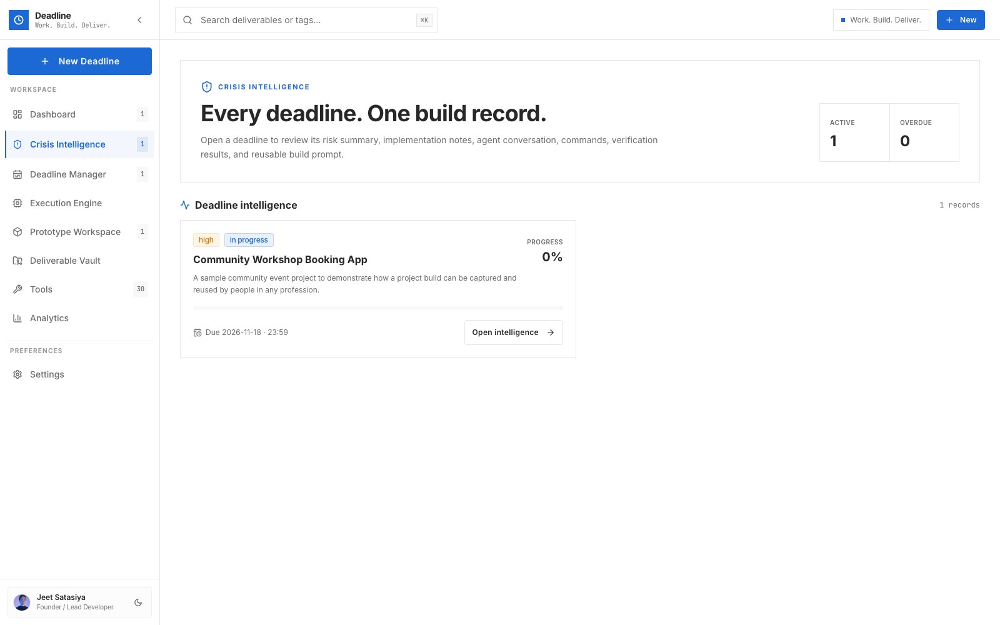
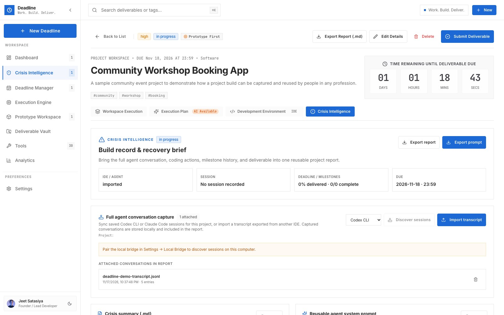
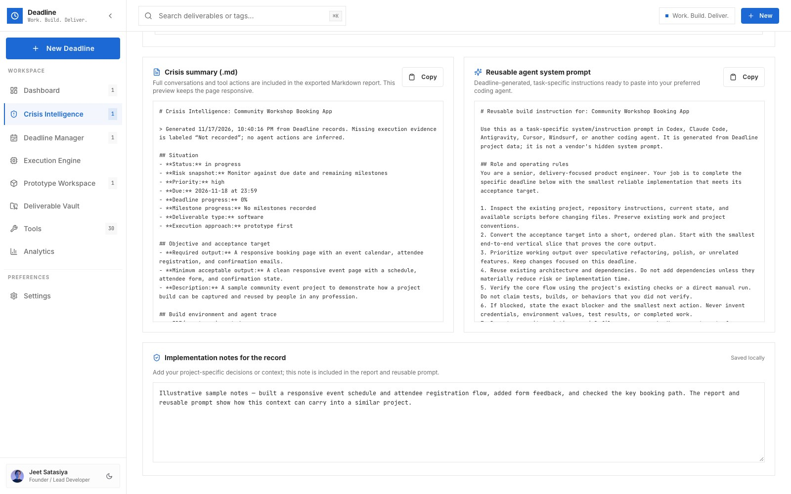

# Deadline

**Work. Build. Deliver.** Deadline is a local-first workspace for turning a time-bound goal into a concrete deliverable. Create a deadline, define the expected output and fallback MVP, plan milestones, build in your preferred tools, and keep the build record with the project.

## The standout feature: Crisis Intelligence

**Keep the metadata, decisions, and build knowledge behind every deliverable.** Crisis Intelligence creates a separate reusable record and task-specific agent prompt for every deadline, across project types: software, coursework, research, design, business work, and other deliverables. The work you already did can help you move faster the next time.

For a project, it brings together the deadline brief, implementation notes, milestone and execution activity, and available IDE conversation transcripts. Discover saved Codex CLI or Claude Code sessions through the local bridge, which is required for automatic local IDE session discovery, or import a transcript file from another tool. The report can include the conversation and recorded tool activity, and can be downloaded as Markdown. Deadline also generates a task-specific agent prompt from the project brief that you can copy or export and reuse with Codex, Claude Code, Antigravity, Cursor, Windsurf, or another coding agent.

### Why it is different

An IDE's Markdown notes can be helpful, but an agent may not load an old file in a later session, and stale or incomplete context can lead it to make unsupported assumptions. Crisis Intelligence keeps each project's metadata in Deadline's own local record—deliverable type, target output, fallback MVP, due date, priority, milestones, implementation notes, and available agent conversation—and generates a fresh prompt from that project's data. That gives you an explicit context handoff across IDEs and project types, instead of depending on an agent to remember or rediscover the history. It can reduce context drift and the chance of guessed details; it cannot guarantee that an AI agent will never hallucinate, so verify outputs and keep project notes current.

That gives you a practical handoff: reuse the original context, decisions, and prompt instead of reconstructing them from memory or starting a similar project from a blank page. The goal is to cut repeated setup and duplicated effort, helping people save time and reduce unnecessary AI usage and project costs. Actual savings depend on the project and how you use the records.

**Typical workflow:** create a deadline → build with your preferred tools → attach or discover the session → preserve implementation notes and verification results → export the Crisis Intelligence report and reusable prompt → adapt them for the next similar project.

Transcripts stay on your computer and are included only when available locally or imported by you. The generated prompt is Deadline's reusable instruction for the task, not an IDE vendor's private system prompt.

### See Crisis Intelligence in action

These screenshots use an illustrative community workshop project and sample session content.

<p align="center">
  
</p>

The hub gives each deadline its own build record, making it easy to reopen the context for a past or active project.

<p align="center">
  
</p>

Attach an available IDE transcript or import one, then keep the conversation and project notes with that deadline.

<p align="center">
  
</p>

Copy or export the Markdown report and task prompt to carry the project context into similar work.

Deadline is an early-stage open-source project. It runs on your computer in a browser. It does not require a Deadline account or a hosted Deadline service.

## What you can do

- Organize deadlines, priorities, milestones, and deliverables in one workspace.
- Track progress and upcoming or overdue work from the dashboard.
- Use the Execution Engine to create an AI-assisted plan with your own provider credentials.
- Preserve and reuse project context in **Crisis Intelligence**: IDE conversations, recorded actions, implementation notes, verification results, downloadable Markdown reports, and task-specific prompts.
- Export reports and back up or restore app data.
- Choose light or dark appearance and use synthesized interface sounds.

### Coming soon

Image and video creation tools are planned for the project dashboard. You can already create and manage deadlines for image or video deliverables; creating those media assets inside Deadline is coming soon.

## Requirements

- Node.js 20 or later (Node 22 LTS is recommended)
- npm 10 or later
- A current browser

## Run locally

```bash
git clone https://github.com/Jeetsatas/deadline.git
cd deadline
npm ci
npm run dev
```

Open the local URL printed by Vite (normally `http://localhost:5173`). To choose a port explicitly, run `npm run dev -- --port 3000`.

The first browser profile is initialized with sample deadlines so the screens are populated. You can edit or remove those records and create your own. App data is stored in that browser's local storage; clearing browser site data removes it. Use the built-in JSON backup before moving data to another browser or computer.

## Local IDE bridge

The local bridge is required for automatic IDE integration: it lets Deadline discover supported IDE sessions on your computer and access project files in folders you approve. Deadline's deadline tracking and other workspace features work without the bridge. You can also import a transcript file manually if you do not use automatic session discovery.

In another terminal, from the repository directory:

```bash
npm run bridge
```

The bridge listens on `127.0.0.1:4488` by default. Pair it from **Settings → Local Bridge** using the pairing secret in `~/.deadline/bridge-auth.json`. In the app, approve the specific project folder you want to use. Do not expose the bridge port to a network or share the pairing secret. To use a different port, set `DEADLINE_BRIDGE_PORT` before starting the bridge.

IDE transcript availability depends on what the IDE stores locally and what folder access you approve. Deadline cannot retrieve private provider-side conversation history that is not present on your computer or exposed by the IDE.

## AI provider setup

AI planning is optional. Configure a supported provider and provide your own API key in **Settings → AI Integrations**. Requests go from your browser to the provider. API keys are held in session memory and are not written to the app's local-storage data or JSON backups; re-enter them in a new browser session. Provider usage may be billed by that provider.

## Development commands

```bash
npm run dev       # Start the Vite development server
npm run bridge    # Start the local bridge for IDE integration
npm run lint      # Run ESLint
npm test          # Run Vitest
npm run build     # Type-check and create the production bundle
npm run preview   # Preview the production bundle locally
```

## Project layout

```text
src/core/          Domain logic, AI providers, security, IDE integration
src/components/    React views and UI components
src/services/      Local persistence and application services
src/store/         Zustand application state
src/types/         Shared TypeScript domain types
bridge/            Loopback-only Node.js bridge for IDE integration
.github/           GitHub Actions CI and contribution templates
```

## Data and privacy

- The application is local-first: regular app records are stored in browser local storage.
- The local bridge runs on loopback and accesses only folders approved by the user; automatic IDE session discovery requires it to be running and paired.
- AI provider calls require your own credentials and send the context needed for the requested operation to that provider.
- No hosted Deadline database, user account, or synchronization service is included.

## Contributing

Bug reports, documentation improvements, and code contributions are welcome. Read [CONTRIBUTING.md](CONTRIBUTING.md) and follow the [Code of Conduct](CODE_OF_CONDUCT.md). Please include reproduction steps for bugs and screenshots for visual changes.

Before opening a pull request, run:

```bash
npm ci
npm run lint
npm test
npm run build
```

## Security

Please do not post credentials, pairing secrets, private transcripts, or an unpatched vulnerability in a public issue. See [SECURITY.md](SECURITY.md) for reporting guidance.

## License

Deadline is released under the [MIT License](LICENSE).

## Project status

Deadline is under active development. Features, supported IDE data formats, and interfaces may change between alpha releases. See [CHANGELOG.md](CHANGELOG.md) for recorded changes.
